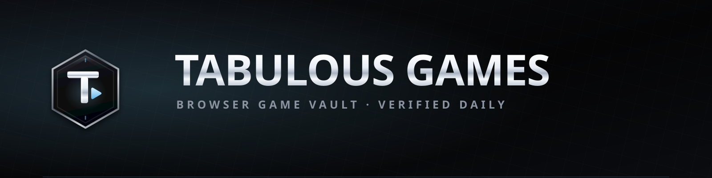

# Tabulous Games — The Curated Browser Gaming Vault


[](https://lin4cre.github.io/tabulous-games/)
[](index.html)
[](https://github.com/LIN4CRE/retro-arcade-vault)
[](https://webassembly.org/)
[](LICENSE)

> **Classic PC masterpieces, iconic shooters, zombies co-op, survivors-likes, and 3D open-world adventures in your browser tab.** No separate game client or launcher; some ports still need your own original files or a substantial first download.

<p align="center">
  
</p>

<p align="center">
  <b>Designed, built, written and maintained by one solo developer.</b><br>
  No studio, no team, no ad network — just a hand-curated catalogue and a bot that keeps it honest.
</p>

---

## 🕹️ Sister Project: Retro Arcade Vault

Looking for vintage console gems? Check out our companion project [**Retro Arcade Vault**](https://github.com/LIN4CRE/retro-arcade-vault) ([Live Demo](https://lin4cre.github.io/retro-arcade-vault/))!

<p align="center">
  <a href="https://github.com/LIN4CRE/retro-arcade-vault">
    
  </a>
</p>

*   **Retro Arcade Vault**: Preloaded with **124 console classics** across PlayStation 1, Game Boy Advance, Nintendo DS, Super Nintendo, and Sega Genesis.
*   **Tabulous Games**: Dedicated to **3D PC ports, shooters, zombies, survivors-likes, and WebAssembly reconstructions**.

Together, they form the ultimate browser-based gaming suite!

---

## 🆕 October 2026 expansion — 9 survivors-likes and 12 new ports

This update was driven by a broad search for **survivors-likes playable in a browser tab** and for **new fan ports** of classic games. Two old entries were removed because their hosts no longer serve a game (see the audit below).

**Survivors & roguelite (9):**

| Title | What it is | Play link |
| :--- | :--- | :--- |
| **Azeroth Survivors** | WoW Classic survivors roguelike by Aethus (WebGPU, 9 classes, 12 zones) — the game also searched as *World of Warcraft Survivors* | [wow.aethus.pl](https://wow.aethus.pl/) |
| **Diablo Survivors** | 3D third-person Diablo survivors-like with drop-in co-op, by izkimar on Spawn | [spawn.co/@izkimar](https://www.spawn.co/@izkimar/diablo-survivors) |
| **D2 Survivors** | Diablo II survivors-like with all 7 classes and D2 loot — needs your own D2/D2R files | [d2survivors.lol](https://d2survivors.lol/play/) |
| **PokéBonk** | 3D Megabonk-style Pokémon survivor by Charcher | [pokebonk.com](https://pokebonk.com/) |
| **PokéSurvivor** | 2D bullet-heaven with 966 Pokémon and 4-player co-op | [pokesurvivor.com](https://pokesurvivor.com/) |
| **Pokémon Survivors** | 15-minute runs, 27 starters, megas, rifts and legendary bosses | [pokemonsurvivors.com](https://www.pokemonsurvivors.com/en/) |
| **Bacon Survivor** | The verified pig/pork-themed survivor game by SnoutUp | [poki.com](https://poki.com/en/g/bacon-survivor) |
| **PokeBonk (Touchzada)** | A second, separate PokeBonk with missions, shop and 8-player online runs | [pokebonk.solais.cloud](https://pokebonk.solais.cloud/) |
| **The Browsing of Isaac** | *Repentance+* recompiled to WebAssembly, streamed in a tab | [tboi.online](https://tboi.online/) |

**New ports & classics (12):** Doom (Wasm Doom), Crash Bash Online, Tomb Raider (OpenLara), Transport Tycoon (OpenTTD Online), Red Alert 2 (Chrono Divide), Road Rash, WipEout, LEGO Island, Lugaru, Alley Cat, SimCity Classic and Cricket 07. Full details, controls and caveats are in the cards and in the table below.

> **Search notes:** no game literally titled *Pork Survivors* could be verified — the closest is **Bacon Survivor**. *World of Warcraft Survivors* and *WoW Survivors* resolve to **Azeroth Survivors**. *Diablo II Survivors* is **D2 Survivors**, while **Diablo Survivors** (Spawn) is a separate 3D co-op game.

---

## 🏎️ October 2026 AAA browser-port sweep — 10 additions

A separate manual sweep checked for missing, recognizable PC and console blockbusters that now have browser builds. Requirements and caveats are intentionally explicit; these are unofficial projects unless stated otherwise.

| Game / build | Requirements and caveats |
| :--- | :--- |
| **Need for Speed: Most Wanted (2005 PC)** — [itch.io web port](https://dezm0n.itch.io/nfs-most-wanted-web-port) | Desktop Chrome/Edge with WebGPU and hardware acceleration; streams and caches game data. Experimental; online/LAN is unsupported, and full-career play plus race-end autosaves still need testing. |
| **Need for Speed: Underground 2** — [Underground 2 Revived](https://nfsu2.xyz/) | WebGPU desktop browser; data streams on demand, with an optional ~1.7 GB preload. Online/free roam uses the project's own community service. |
| **Burnout 3: Takedown** — [browser preview](https://burnout3.online/) | PS2 web recompilation; current Chrome/Edge with WebGPU recommended. Profile saving is broken (answer No to the save prompt), the first race has ~3 minutes of unskippable training, and online is experimental. |
| **Midnight Club 3: DUB Edition** — [PSP browser port](https://midnighhtclub3.online/) | This is the PSP release, not the PS2 Remix. Browser storage keeps saves; the host advertises private Ad Hoc rooms, but treat online play as experimental. |
| **Resident Evil Outbreak + File #2** — [OutbreakWeb](https://outbreakweb.com/) | Host loads the game automatically; modern WebAssembly features are required and WebGPU is recommended. Unofficial, not affiliated with Capcom; the host publishes no source/authorization details, and service stability and availability are uncertain. Browser memory-card saves should be exported. |
| **Fallout 1 + 2** — [Rerun Reactor](https://www.rerunreactor.com/) | Bring your own legally purchased game folder, ZIP or disc image. No game content is bundled; imports and saves stay local in browser storage. |
| **StarCraft: Brood War** — [OpenBW Web](https://playscbw.com/) | First play downloads about 90 MB of original data from Internet Archive and caches it. Browser RTS with AI, friend rooms and online matches; non-commercial fan project. |
| **Command & Conquer: Generals — Zero Hour** — [GeneralsX Web](https://generals.wasm.ltd/) | Requires your own Generals and Zero Hour files, selected from an install folder or archive; files remain on your machine. WebGPU-capable desktop browser recommended. |
| **Warcraft III** — [Warsmash](https://warsmash.pages.dev/) | Stage your own Warcraft III install through the asset manager; files stay in private browser storage. Unofficial, in-progress client. |
| **S.T.A.L.K.E.R.: Call of Pripyat / Call of Chernobyl** — [ZoneVM](https://zonevm.btr.pm/) | Requires your own game folder; the client uses browser-private storage and copies saves back. Very WIP, with expected bugs/crashes; Right Shift replaces Esc for in-game menus, and Ctrl+W can close the tab. |

**Not added after checks:** Portal's host returned Cloudflare 521; Half-Life 2 returned 404; Chinatown Wars stalled at 4 MB of 862 MB with 0 FPS; the public Morrowind host was invite-only with its player app missing; and Doom 3's demo raised a runtime exception. They remain in the transparency log rather than being presented as playable.

---

## 🚀 The Curated Library (303 entries, 38 instant-play)

Every card links to the project's own site. Large downloads, WebGPU requirements and "bring your own game files" cases are called out in each card's **Good to Know** box rather than hidden:

<!-- GAMES-TABLE:START -->
| Game Title | Platform / Tech | Genre | Status |
| :--- | :--- | :--- | :--- |
| **Need for Speed: Most Wanted — Web Port** 🆕 | PC Recompilation / WebAssembly / WebGPU | Sports &amp; Arcade | ⚡ Instant Play |
| **Super Mario 64 (PC Port WebGL)** 🆕 | sm64pc / WebAssembly / WebGL | Classic PC &amp; Retro Ports | ⚡ Instant Play |
| **Townscaper (Web Edition)** 🆕 | Unity WebGL / WebAssembly | Strategy &amp; Management | ⚡ Instant Play |
| **Celeste Classic (PICO-8)** 🆕 | PICO-8 / WebAssembly | Classic PC &amp; Retro Ports | ⚡ Instant Play |
| **Legend of Legaia (Web Recompilation)** 🆕 | PS1 Recompilation / WebGL / WebAssembly | Classic PC &amp; Retro Ports | ⚡ Instant Play |
| **After Burner II (HTML5 Arcade Port)** 🆕 | melonJS / HTML5 Canvas / WebGL | Sports &amp; Arcade | ⚡ Instant Play |
| **Web Dashers (Geometry Rhythm Platformer)** 🆕 | HTML5 Canvas / WebGL | Sports &amp; Arcade | ⚡ Instant Play |
| **Pokémon Mystery Dungeon: Web Engine** 🆕 | HTML5 Canvas / WebAudio | Strategy &amp; Management | ⚡ Instant Play |
| **Hege Mania (Browser Bullet Heaven)** 🆕 | HTML5 Canvas / WebGL | Bullet Heaven &amp; Survivors | ⚡ Instant Play |
| **APEX GP 26 (3D Formula Racer)** 🆕 | WebGPU / WebGL / Three.js | Sports &amp; Arcade | ⚡ Instant Play |
| **CrossCode (HTML5 Action-RPG)** 🆕 | ImpactJS / HTML5 Canvas | Classic PC &amp; Retro Ports | ⚡ Instant Play |
| **Venge.io (Tactical 3D Hero Shooter)** 🆕 | PlayCanvas / WebGL Engine | Shooters &amp; FPS | 🌐 Multiplayer |
| **Shell Shockers (3D Egg Battle FPS)** 🆕 | Babylon.js / WebGL | Shooters &amp; FPS | 🌐 Multiplayer |
| **Smash Karts (3D Kart Battle Arena)** 🆕 | Unity WebGL / 3D Engine | Sports &amp; Arcade | 🌐 Multiplayer |
| **Krunker.io (3D Multiplayer FPS)** 🆕 | WebGL / Custom 3D Engine | Shooters &amp; FPS | 🌐 Multiplayer |
| **Need for Speed: Underground 2 (Web)** 🆕 | PC Recompilation / WebGPU | Sports &amp; Arcade | 🌐 Multiplayer |
| **Burnout 3: Takedown (Web Preview)** 🆕 | PS2 Web Recomp / WebAssembly / WebGPU | Sports &amp; Arcade | 🌐 Multiplayer |
| **Midnight Club 3: DUB Edition (Web)** 🆕 | PSP Web Recomp / WebAssembly / WebGL | Sports &amp; Arcade | 🌐 Multiplayer |
| **Resident Evil Outbreak &amp; File #2 (Web)** 🆕 | WebAssembly / WebGPU Browser Client | Zombies &amp; Co-op | 🌐 Multiplayer |
| **Fallout 1 &amp; 2 (Rerun Reactor)** 🆕 | Fallout Community Edition / WebAssembly | Classic PC &amp; Retro Ports | 📁 Custom Files |
| **StarCraft: Brood War (OpenBW Web)** 🆕 | OpenBW / WebAssembly | Strategy &amp; Sim | 🌐 Multiplayer |
| **Command &amp; Conquer: Generals — Zero Hour (GeneralsX Web)** 🆕 | GeneralsX / WebAssembly Decompilation | Strategy &amp; Sim | 📁 Custom Files |
| **Warcraft III (Warsmash Web)** 🆕 | Warsmash Browser Client / WebGL | Strategy &amp; Sim | 📁 Custom Files |
| **S.T.A.L.K.E.R.: Call of Pripyat (ZoneVM)** 🆕 | OpenXRay / WebAssembly | Shooters &amp; FPS | 📁 Custom Files |
| **Azeroth Survivors (World of Warcraft Survivors)** 🆕 | WebGPU / Rust + Bevy WASM | Survivors &amp; Roguelite | ⚡ Instant Play |
| **Diablo Survivors (3D Multiplayer)** 🆕 | WebGL / Spawn Engine | Survivors &amp; Roguelite | ⚡ Instant Play |
| **D2 Survivors (Diablo II Survivors)** 🆕 | WebAssembly / Own D2 Files | Survivors &amp; Roguelite | 📁 Custom Files |
| **PokéBonk (3D Pokémon Survivors)** 🆕 | WebGL / 3D Megabonk-style | Survivors &amp; Roguelite | ⚡ Instant Play |
| **PokéSurvivor (966 Pokémon)** 🆕 | HTML5 Canvas / WebGL | Survivors &amp; Roguelite | ⚡ Instant Play |
| **Pokémon Survivors (Bullet Heaven)** 🆕 | HTML5 / Canvas | Survivors &amp; Roguelite | ⚡ Instant Play |
| **Bacon Survivor (Pork Survivors-like)** 🆕 | HTML5 / Canvas | Survivors &amp; Roguelite | ⚡ Instant Play |
| **Doom (Wasm Doom)** 🆕 | Chocolate Doom WASM / WebSockets | Classic PC &amp; Retro Ports | ⚡ Instant Play |
| **Crash Bash Online** 🆕 | WebGL / Server-side Game Logic | Sports &amp; Arcade | 🌐 Multiplayer |
| **Tomb Raider (OpenLara)** 🆕 | WebGL / WebAssembly Engine Rewrite | Classic PC &amp; Retro Ports | ⚡ Instant Play |
| **OpenTTD Online (Transport Tycoon)** 🆕 | WebAssembly / OpenGFX | Strategy &amp; Sim | ⚡ Instant Play |
| **Chrono Divide (Red Alert 2)** 🆕 | WebGL / JavaScript Engine Rewrite | Strategy &amp; Sim | 📁 Custom Files |
| **Road Rash (Three.js Port)** 🆕 | Three.js / WebGL | Sports &amp; Arcade | ⚡ Instant Play |
| **WipEout (wipeout-rewrite)** 🆕 | WebAssembly / WebGL | Sports &amp; Arcade | ⚡ Instant Play |
| **LEGO Island (isle.pizza)** 🆕 | WebAssembly / Decompilation | Open World &amp; Action | ⚡ Instant Play |
| **Lugaru (Lugaru-Web)** 🆕 | WebAssembly / OSS Lugaru | Open World &amp; Action | ⚡ Instant Play |
| **Alley Cat (alleycat.exe)** 🆕 | Static Recompilation / WASM | Classic PC &amp; Retro Ports | ⚡ Instant Play |
| **SimCity Classic (micropolisJS)** 🆕 | JavaScript / HTML5 Canvas | Strategy &amp; Sim | ⚡ Instant Play |
| **Cricket 07 (Browser Recompilation)** 🆕 | WebAssembly / WebGPU Recompilation | Sports &amp; Arcade | ⚡ Instant Play |
| **Counter-Strike Surf (Surfd.net)** | WebGL / Source Physics Engine | Shooters &amp; FPS | ⚡ Instant Play |
| **Halo: Combat Evolved (Combat Lab)** | WebGL / WebAssembly Engine | Shooters &amp; FPS | ⚡ Instant Play |
| **Skate 3 (Web Fan Project)** | WebGL / Canvas Physics | Sports &amp; Arcade | ⚡ Instant Play |
| **Pro Evolution Soccer 6 (PES 6 Web)** | PPSSPP WebAssembly Emulation | Sports &amp; Arcade | ⚡ Instant Play |
| **Grand Theft Auto: Vice City (reVC WASM)** | reVC WebAssembly / WebGL | Open World &amp; Action | ⚡ Instant Play |
| **Grand Theft Auto III (re3 WASM)** | re3 WebAssembly / WebGL | Open World &amp; Action | ⚡ Instant Play |
| **The Simpsons: Hit &amp; Run (SHAR WASM)** | WebAssembly / Cloudflare Workers | Open World &amp; Action | ⚡ Instant Play |
| **Minecraft Java 1.8.8 (Eaglercraft WASM)** | TeaVM / WebAssembly Java | Open World &amp; Action | ⚡ Instant Play |
| **Quake (QuakeWorld Online)** | WebQuake / WebGL / WebSockets | Classic PC &amp; Retro Ports | 🌐 Multiplayer |
| **Quake II (JSQuake II)** | WebGL / WebAssembly Netcode | Classic PC &amp; Retro Ports | 🌐 Multiplayer |
| **Quake III Arena (ioquake3 Web)** | ioquake3 WebAssembly / WebGL | Classic PC &amp; Retro Ports | 🌐 Multiplayer |
| **Return to Castle Wolfenstein (iortcw Web)** | iortcw WebAssembly / WebGL | Classic PC &amp; Retro Ports | 🌐 Multiplayer |
| **Urban Terror (ut.pieter.com)** | ioquake3 WebAssembly | Shooters &amp; FPS | ⚡ Instant Play |
| **Half-Life (Pixelsuft WebXash)** | Xash3D FWGS WebAssembly | Classic PC &amp; Retro Ports | ⚡ Instant Play |
| **Counter-Strike 1.6 (webXash)** | Xash3D WebAssembly Framework | Shooters &amp; FPS | 📁 Custom Files |
| **Diablo 1 (DiabloWeb / DevilutionX)** | DevilutionX WebAssembly | Classic PC &amp; Retro Ports | ⚡ Instant Play |
| **Zelda 64: Recompiled (The Legend of Zelda: Majora's Mask)** 🆕 | Static Recompilation / Native C++ | Classic PC &amp; Retro Ports | 📁 Custom Files |
| **Dusklight (The Legend of Zelda: Twilight Princess)** 🆕 | Static Recompilation / Native C++ | Classic PC &amp; Retro Ports | 📁 Custom Files |
| **Ship of Harkinian (The Legend of Zelda: Ocarina of Time)** 🆕 | Static Recompilation / Native C++ | Classic PC &amp; Retro Ports | 📁 Custom Files |
| **Unleashed Recompiled (Sonic Unleashed)** 🆕 | Static Recompilation / Native C++ | Classic PC &amp; Retro Ports | 📁 Custom Files |
| **SpaghettiKart (Mario Kart 64)** 🆕 | Static Recompilation / Native C++ | Sports &amp; Arcade | 📁 Custom Files |
| **Starship (Star Fox 64)** 🆕 | Static Recompilation / Native C++ | Classic PC &amp; Retro Ports | 📁 Custom Files |
| **Banjo: Recompiled (Banjo-Kazooie)** 🆕 | Static Recompilation / Native C++ | Classic PC &amp; Retro Ports | 📁 Custom Files |
| **Donkey Kong 64: Recompiled** 🆕 | Static Recompilation / Native C++ | Classic PC &amp; Retro Ports | 📁 Custom Files |
| **Conker BFD Reloaded (Conker's Bad Fur Day)** 🆕 | Static Recompilation / Native C++ | Classic PC &amp; Retro Ports | 📁 Custom Files |
| **Snap 64 Recomp (Pokémon Snap)** 🆕 | Static Recompilation / Native C++ | Classic PC &amp; Retro Ports | 📁 Custom Files |
| **No Mercy Recomp (WWF No Mercy)** 🆕 | Static Recompilation / Native C++ | Sports &amp; Arcade | 📁 Custom Files |
| **WrestleMania 2000 Recomp (WWF WrestleMania 2000)** 🆕 | Static Recompilation / Native C++ | Sports &amp; Arcade | 📁 Custom Files |
| **World Tour Recomp (WCW vs. nWo: World Tour)** 🆕 | Static Recompilation / Native C++ | Sports &amp; Arcade | 📁 Custom Files |
| **Revenge Recomp (WCW/nWo Revenge)** 🆕 | Static Recompilation / Native C++ | Sports &amp; Arcade | 📁 Custom Files |
| **VPW64 Recomp (Virtual Pro Wrestling 64)** 🆕 | Static Recompilation / Native C++ | Sports &amp; Arcade | 📁 Custom Files |
| **SVR2007 Recomp (WWE SmackDown vs. Raw 2007)** 🆕 | Static Recompilation / Native C++ | Sports &amp; Arcade | 📁 Custom Files |
| **SVR2008 Recomp (WWE SmackDown vs. Raw 2008)** 🆕 | Static Recompilation / Native C++ | Sports &amp; Arcade | 📁 Custom Files |
| **SVR2009 Recomp (WWE SmackDown vs. Raw 2009)** 🆕 | Static Recompilation / Native C++ | Sports &amp; Arcade | 📁 Custom Files |
| **SVR2010 Recomp (WWE SmackDown vs. Raw 2010)** 🆕 | Static Recompilation / Native C++ | Sports &amp; Arcade | 📁 Custom Files |
| **All Stars Recomp (WWE All Stars)** 🆕 | Static Recompilation / Native C++ | Sports &amp; Arcade | 📁 Custom Files |
| **WWE '13 Recomp** 🆕 | Static Recompilation / Native C++ | Sports &amp; Arcade | 📁 Custom Files |
| **WWE 2K14 Recomp** 🆕 | Static Recompilation / Native C++ | Sports &amp; Arcade | 📁 Custom Files |
| **Uncharted PC Port (Uncharted: The Nathan Drake Collection)** 🆕 | Static Recompilation / Native C++ | Open World &amp; Action | 📁 Custom Files |
| **Def Jam FFNY Recomp (Def Jam: Fight for NY)** 🆕 | Static Recompilation / Native C++ | Classic PC &amp; Retro Ports | 📁 Custom Files |
| **Xerenge (Burnout Revenge)** 🆕 | Static Recompilation / Native C++ | Sports &amp; Arcade | 📁 Custom Files |
| **ReStreet (FIFA Street)** 🆕 | Static Recompilation / Native C++ | Sports &amp; Arcade | 📁 Custom Files |
| **Perfect Dark Port** 🆕 | Static Recompilation / Native C++ | Shooters &amp; FPS | 📁 Custom Files |
| **Drakengard 3 Recompiled** 🆕 | Static Recompilation / Native C++ | Classic PC &amp; Retro Ports | 📁 Custom Files |
| **FM4 Recomp (Forza Motorsport 4)** 🆕 | Static Recompilation / Native C++ | Sports &amp; Arcade | 📁 Custom Files |
| **Estacado (The Darkness)** 🆕 | Static Recompilation / Native C++ | Shooters &amp; FPS | 📁 Custom Files |
| **Case Zero Recomp (Dead Rising 2: Case Zero)** 🆕 | Static Recompilation / Native C++ | Zombies &amp; Co-op | 📁 Custom Files |
| **WET Recomp** 🆕 | Static Recompilation / Native C++ | Shooters &amp; FPS | 📁 Custom Files |
| **Army of Two Recomp** 🆕 | Static Recompilation / Native C++ | Shooters &amp; FPS | 📁 Custom Files |
| **Pilotwings 64 Recomp** 🆕 | Static Recompilation / Native C++ | Classic PC &amp; Retro Ports | 📁 Custom Files |
| **Skate 2 PC** 🆕 | Static Recompilation / Native C++ | Sports &amp; Arcade | 📁 Custom Files |
| **AeroGauge Recomp** 🆕 | Static Recompilation / Native C++ | Sports &amp; Arcade | 📁 Custom Files |
| **Def Jam Vendetta Recomp** 🆕 | Static Recompilation / Native C++ | Classic PC &amp; Retro Ports | 📁 Custom Files |
| **BattleTanx PC Port (BattleTanx: Global Assault)** 🆕 | Static Recompilation / Native C++ | Shooters &amp; FPS | 📁 Custom Files |
| **ISS 2000 Widescreen (International Superstar Soccer 2000)** 🆕 | Static Recompilation / Native C++ | Sports &amp; Arcade | 📁 Custom Files |
| **WWE 2K16 PC** 🆕 | Static Recompilation / Native C++ | Sports &amp; Arcade | 📁 Custom Files |
| **Power Dozer (Blast Corps)** 🆕 | Static Recompilation / Native C++ | Classic PC &amp; Retro Ports | 📁 Custom Files |
| **Blocksphere (Tetrisphere)** 🆕 | Static Recompilation / Native C++ | Classic PC &amp; Retro Ports | 📁 Custom Files |
| **Wind Waker HD Recomp (The Legend of Zelda: The Wind Waker HD)** 🆕 | Static Recompilation / Native C++ | Classic PC &amp; Retro Ports | 📁 Custom Files |
| **Symphony Recomp (Castlevania: Symphony of the Night)** 🆕 | Static Recompilation / Native C++ | Classic PC &amp; Retro Ports | 📁 Custom Files |
| **reblue (Blue Dragon)** 🆕 | Static Recompilation / Native C++ | Classic PC &amp; Retro Ports | 📁 Custom Files |
| **Lost Odyssey Recomp** 🆕 | Static Recompilation / Native C++ | Classic PC &amp; Retro Ports | 📁 Custom Files |
| **Silent Hill Decomp** 🆕 | Static Recompilation / Native C++ | Zombies &amp; Co-op | 📁 Custom Files |
| **Hell's Gate (Dante's Inferno)** 🆕 | Static Recompilation / Native C++ | Classic PC &amp; Retro Ports | 📁 Custom Files |
| **Tenkaichi 3 Decomp (Dragon Ball Z: Budokai Tenkaichi 3)** 🆕 | Static Recompilation / Native C++ | Classic PC &amp; Retro Ports | 📁 Custom Files |
| **Fable 2 Recomp (Fable II)** 🆕 | Static Recompilation / Native C++ | Open World &amp; Action | 📁 Custom Files |
| **Yakumo (Monster Hunter Portable 3rd)** 🆕 | Static Recompilation / Native C++ | Classic PC &amp; Retro Ports | 📁 Custom Files |
| **BattleShip (Super Smash Bros.)** 🆕 | Static Recompilation / Native C++ | Classic PC &amp; Retro Ports | 📁 Custom Files |
| **Edge of Time Recomp (Spider-Man: Edge of Time)** 🆕 | Static Recompilation / Native C++ | Open World &amp; Action | 📁 Custom Files |
| **Sky Recomp (The Legend of Zelda: Skyward Sword)** 🆕 | Static Recompilation / Native C++ | Classic PC &amp; Retro Ports | 📁 Custom Files |
| **Nocturne Recomp (Shin Megami Tensei III: Nocturne)** 🆕 | Static Recompilation / Native C++ | Classic PC &amp; Retro Ports | 📁 Custom Files |
| **The Simpsons Game Recomp** 🆕 | Static Recompilation / Native C++ | Classic PC &amp; Retro Ports | 📁 Custom Files |
| **Strikers (Super Mario Strikers)** 🆕 | Static Recompilation / Native C++ | Classic PC &amp; Retro Ports | 📁 Custom Files |
| **Project Midas (GoldenEye 007)** 🆕 | Static Recompilation / Native C++ | Classic PC &amp; Retro Ports | 📁 Custom Files |
| **Downpour Recomp (Silent Hill: Downpour)** 🆕 | Static Recompilation / Native C++ | Shooters &amp; FPS | 📁 Custom Files |
| **Dinosaur Planet Recomp** 🆕 | Static Recompilation / Native C++ | Classic PC &amp; Retro Ports | 📁 Custom Files |
| **Bomberman 64: Recompiled** 🆕 | Static Recompilation / Native C++ | Classic PC &amp; Retro Ports | 📁 Custom Files |
| **G-Diffuser (F-Zero X)** 🆕 | Static Recompilation / Native C++ | Sports &amp; Arcade | 📁 Custom Files |
| **Quest 64 Recomp** 🆕 | Static Recompilation / Native C++ | Classic PC &amp; Retro Ports | 📁 Custom Files |
| **Condemned 2 Recomp (Condemned 2: Bloodshot)** 🆕 | Static Recompilation / Native C++ | Zombies &amp; Co-op | 📁 Custom Files |
| **ReTiP (Viva Piñata: Trouble in Paradise)** 🆕 | Static Recompilation / Native C++ | Classic PC &amp; Retro Ports | 📁 Custom Files |
| **King Kong Recompiled (Peter Jackson's King Kong)** 🆕 | Static Recompilation / Native C++ | Classic PC &amp; Retro Ports | 📁 Custom Files |
| **PGR4 Recomp (Project Gotham Racing 4)** 🆕 | Static Recompilation / Native C++ | Sports &amp; Arcade | 📁 Custom Files |
| **Mega Man X Recomp** 🆕 | Static Recompilation / Native C++ | Classic PC &amp; Retro Ports | 📁 Custom Files |
| **Rise of a Ninja Recomp (Naruto: Rise of a Ninja)** 🆕 | Static Recompilation / Native C++ | Classic PC &amp; Retro Ports | 📁 Custom Files |
| **reNut (Banjo-Kazooie: Nuts &amp; Bolts)** 🆕 | Static Recompilation / Native C++ | Classic PC &amp; Retro Ports | 📁 Custom Files |
| **DP Recomp (Deadly Premonition)** 🆕 | Static Recompilation / Native C++ | Classic PC &amp; Retro Ports | 📁 Custom Files |
| **Harvest Moon 64 Recomp** 🆕 | Static Recompilation / Native C++ | Classic PC &amp; Retro Ports | 📁 Custom Files |
| **MCLA Recomp (Midnight Club: Los Angeles)** 🆕 | Static Recompilation / Native C++ | Classic PC &amp; Retro Ports | 📁 Custom Files |
| **SDOJ Recomp (DoDonPachi SaiDaiOuJou)** 🆕 | Static Recompilation / Native C++ | Classic PC &amp; Retro Ports | 📁 Custom Files |
| **Eternal Sonata Reprise** 🆕 | Static Recompilation / Native C++ | Classic PC &amp; Retro Ports | 📁 Custom Files |
| **CVLoD Recomp (Castlevania: Legacy of Darkness)** 🆕 | Static Recompilation / Native C++ | Shooters &amp; FPS | 📁 Custom Files |
| **Super Mario World Recomp** 🆕 | Static Recompilation / Native C++ | Classic PC &amp; Retro Ports | 📁 Custom Files |
| **Budokai HD Recompiled (Dragon Ball Z: Budokai)** 🆕 | Static Recompilation / Native C++ | Classic PC &amp; Retro Ports | 📁 Custom Files |
| **Finest Hour Remastered (Call of Duty: Finest Hour)** 🆕 | Static Recompilation / Native C++ | Shooters &amp; FPS | 📁 Custom Files |
| **Gears Judgment Recomp (Gears of War: Judgment)** 🆕 | Static Recompilation / Native C++ | Shooters &amp; FPS | 📁 Custom Files |
| **Snowboard Kids 2 Recomp** 🆕 | Static Recompilation / Native C++ | Classic PC &amp; Retro Ports | 📁 Custom Files |
| **SSSV Recomp (Space Station Silicon Valley)** 🆕 | Static Recompilation / Native C++ | Classic PC &amp; Retro Ports | 📁 Custom Files |
| **Open Nectar (Pikmin)** 🆕 | Static Recompilation / Native C++ | Classic PC &amp; Retro Ports | 📁 Custom Files |
| **Forbidden Memories Recompiled (Yu-Gi-Oh! Forbidden Memories)** 🆕 | Static Recompilation / Native C++ | Classic PC &amp; Retro Ports | 📁 Custom Files |
| **Budokai 3 HD Recomp (Dragon Ball Z: Budokai 3)** 🆕 | Static Recompilation / Native C++ | Classic PC &amp; Retro Ports | 📁 Custom Files |
| **TTT2 PC (Tekken Tag Tournament 2)** 🆕 | Static Recompilation / Native C++ | Classic PC &amp; Retro Ports | 📁 Custom Files |
| **Ridge Racer 6 Recomp** 🆕 | Static Recompilation / Native C++ | Sports &amp; Arcade | 📁 Custom Files |
| **Burst Limit Recompiled (Dragon Ball Z: Burst Limit)** 🆕 | Static Recompilation / Native C++ | Classic PC &amp; Retro Ports | 📁 Custom Files |
| **SvR 2011 PC Port (WWE SmackDown vs. Raw 2011)** 🆕 | Static Recompilation / Native C++ | Sports &amp; Arcade | 📁 Custom Files |
| **Rumble Roses XX Recomp** 🆕 | Static Recompilation / Native C++ | Classic PC &amp; Retro Ports | 📁 Custom Files |
| **JSRF Unleashed (Jet Set Radio Future)** 🆕 | Static Recompilation / Native C++ | Classic PC &amp; Retro Ports | 📁 Custom Files |
| **Dragon Age: Origins Recompiled** 🆕 | Static Recompilation / Native C++ | Classic PC &amp; Retro Ports | 📁 Custom Files |
| **SpartanPort (God of War III Remastered)** 🆕 | Static Recompilation / Native C++ | Classic PC &amp; Retro Ports | 📁 Custom Files |
| **CTR Nitro-Fueled Online (Crash Team Racing Nitro-Fueled)** 🆕 | Static Recompilation / Native C++ | Sports &amp; Arcade | 📁 Custom Files |
| **reSOT (Prince of Persia: The Sands of Time)** 🆕 | Static Recompilation / Native C++ | Classic PC &amp; Retro Ports | 📁 Custom Files |
| **Crash of the Titans** 🆕 | Static Recompilation / Native C++ | Classic PC &amp; Retro Ports | 📁 Custom Files |
| **Ninja Gaiden Black Recomp** 🆕 | Static Recompilation / Native C++ | Shooters &amp; FPS | 📁 Custom Files |
| **Savage Wind Recomp (The Legend of Zelda: Breath of the Wild)** 🆕 | Static Recompilation / Native C++ | Classic PC &amp; Retro Ports | 📁 Custom Files |
| **BLACK XBE Recomp** 🆕 | Static Recompilation / Native C++ | Classic PC &amp; Retro Ports | 📁 Custom Files |
| **Driveclub Recomp** 🆕 | Static Recompilation / Native C++ | Classic PC &amp; Retro Ports | 📁 Custom Files |
| **AC6 Recomp (Ace Combat 6: Fires of Liberation)** 🆕 | Static Recompilation / Native C++ | Classic PC &amp; Retro Ports | 📁 Custom Files |
| **B2 Recomp (Bayonetta 2)** 🆕 | Static Recompilation / Native C++ | Classic PC &amp; Retro Ports | 📁 Custom Files |
| **ICO PC** 🆕 | Static Recompilation / Native C++ | Classic PC &amp; Retro Ports | 📁 Custom Files |
| **SCDA XBE Recomp (Tom Clancy's Splinter Cell: Double Agent)** 🆕 | Static Recompilation / Native C++ | Classic PC &amp; Retro Ports | 📁 Custom Files |
| **CoD3 Recomp (Call of Duty 3)** 🆕 | Static Recompilation / Native C++ | Shooters &amp; FPS | 📁 Custom Files |
| **Goemon64 Recomp (Mystical Ninja Starring Goemon (Nintendo 64))** 🆕 | Static Recompilation / Native C++ | Classic PC &amp; Retro Ports | 📁 Custom Files |
| **Project Cane (Sly Cooper and the Thievius Raccoonus)** 🆕 | Static Recompilation / Native C++ | Classic PC &amp; Retro Ports | 📁 Custom Files |
| **Mega Man 64 Recompiled** 🆕 | Static Recompilation / Native C++ | Classic PC &amp; Retro Ports | 📁 Custom Files |
| **Luigi's Mansion Recomp** 🆕 | Static Recompilation / Native C++ | Classic PC &amp; Retro Ports | 📁 Custom Files |
| **DKC1 Recomp (Donkey Kong Country)** 🆕 | Static Recompilation / Native C++ | Classic PC &amp; Retro Ports | 📁 Custom Files |
| **OpenShao (Mortal Kombat: Shaolin Monks)** 🆕 | Static Recompilation / Native C++ | Classic PC &amp; Retro Ports | 📁 Custom Files |
| **DKR-R (Diddy Kong Racing)** 🆕 | Static Recompilation / Native C++ | Sports &amp; Arcade | 📁 Custom Files |
| **Dimensions Recomp (LEGO Dimensions)** 🆕 | Static Recompilation / Native C++ | Shooters &amp; FPS | 📁 Custom Files |
| **DOAXVB RE (Dead or Alive Xtreme Beach Volleyball)** 🆕 | Static Recompilation / Native C++ | Classic PC &amp; Retro Ports | 📁 Custom Files |
| **KH Days Port (Kingdom Hearts 358/2 Days)** 🆕 | Static Recompilation / Native C++ | Strategy &amp; Sim | 📁 Custom Files |
| **Mercenaries Recompiled (Mercenaries: Playground of Destruction)** 🆕 | Static Recompilation / Native C++ | Classic PC &amp; Retro Ports | 📁 Custom Files |
| **MW2 Recompiled (Call of Duty: Modern Warfare 2)** 🆕 | Static Recompilation / Native C++ | Shooters &amp; FPS | 📁 Custom Files |
| **Mega Man X4 Recomp** 🆕 | Static Recompilation / Native C++ | Classic PC &amp; Retro Ports | 📁 Custom Files |
| **Hercules Recompiled (Disney's Hercules)** 🆕 | Static Recompilation / Native C++ | Classic PC &amp; Retro Ports | 📁 Custom Files |
| **Banjo-Tooie Port** 🆕 | Static Recompilation / Native C++ | Classic PC &amp; Retro Ports | 📁 Custom Files |
| **Case West Recomp (Dead Rising 2: Case West)** 🆕 | Static Recompilation / Native C++ | Zombies &amp; Co-op | 📁 Custom Files |
| **Gears of War 2 PC Port** 🆕 | Static Recompilation / Native C++ | Shooters &amp; FPS | 📁 Custom Files |
| **Storm Generations Port (Naruto Shippūden: Ultimate Ninja STORM Generations)** 🆕 | Static Recompilation / Native C++ | Classic PC &amp; Retro Ports | 📁 Custom Files |
| **FIFA WC 2014 Recompiled (2014 FIFA World Cup Brazil)** 🆕 | Static Recompilation / Native C++ | Sports &amp; Arcade | 📁 Custom Files |
| **Kameo RePowered (Kameo: Elements of Power)** 🆕 | Static Recompilation / Native C++ | Classic PC &amp; Retro Ports | 📁 Custom Files |
| **Crackdown Recompiled** 🆕 | Static Recompilation / Native C++ | Classic PC &amp; Retro Ports | 📁 Custom Files |
| **God of War II Recomp** 🆕 | Static Recompilation / Native C++ | Classic PC &amp; Retro Ports | 📁 Custom Files |
| **Tekken 6 Recomp** 🆕 | Static Recompilation / Native C++ | Classic PC &amp; Retro Ports | 📁 Custom Files |
| **Downhill Revived (Downhill Domination)** 🆕 | Static Recompilation / Native C++ | Classic PC &amp; Retro Ports | 📁 Custom Files |
| **VF1 Recomp (Virtua Fighter)** 🆕 | Static Recompilation / Native C++ | Shooters &amp; FPS | 📁 Custom Files |
| **SkullBurglar (50 Cent: Blood on the Sand)** 🆕 | Static Recompilation / Native C++ | Classic PC &amp; Retro Ports | 📁 Custom Files |
| **Rush 2 Recompiled (Rush 2: Extreme Racing USA)** 🆕 | Static Recompilation / Native C++ | Sports &amp; Arcade | 📁 Custom Files |
| **Shake It! Native PC (Wario Land: Shake It!)** 🆕 | Static Recompilation / Native C++ | Classic PC &amp; Retro Ports | 📁 Custom Files |
| **Mega Man X5 Recomp** 🆕 | Static Recompilation / Native C++ | Classic PC &amp; Retro Ports | 📁 Custom Files |
| **Geometry Wars 2 Recomp (Geometry Wars: Retro Evolved 2)** 🆕 | Static Recompilation / Native C++ | Strategy &amp; Sim | 📁 Custom Files |
| **Vandal Hearts PC Port** 🆕 | Static Recompilation / Native C++ | Strategy &amp; Sim | 📁 Custom Files |
| **Project8 Recomp (Tony Hawk's Project 8)** 🆕 | Static Recompilation / Native C++ | Classic PC &amp; Retro Ports | 📁 Custom Files |
| **Bloodborne PC (bbport / ShadPS4)** 🆕 | Static Recompilation / Native C++ | Shooters &amp; FPS | 📁 Custom Files |
| **Streetball Revival (NBA Street Vol. 2)** 🆕 | Static Recompilation / Native C++ | Sports &amp; Arcade | 📁 Custom Files |
| **Renegade Squadron PC (Star Wars Battlefront: Renegade Squadron)** 🆕 | Static Recompilation / Native C++ | Strategy &amp; Sim | 📁 Custom Files |
| **RampageRE (Rampage: Total Destruction)** 🆕 | Static Recompilation / Native C++ | Classic PC &amp; Retro Ports | 📁 Custom Files |
| **SMS Launcher (Super Mario Sunshine)** 🆕 | Static Recompilation / Native C++ | Classic PC &amp; Retro Ports | 📁 Custom Files |
| **rac-rs (Ratchet &amp; Clank)** 🆕 | Static Recompilation / Native C++ | Classic PC &amp; Retro Ports | 📁 Custom Files |
| **LAS Recomp (The Legend of Zelda: Link's Awakening)** 🆕 | Static Recompilation / Native C++ | Classic PC &amp; Retro Ports | 📁 Custom Files |
| **Let's Go Recomp (Pokémon: Let's Go, Pikachu!)** 🆕 | Static Recompilation / Native C++ | Classic PC &amp; Retro Ports | 📁 Custom Files |
| **Marathon Recomp (Sonic the Hedgehog (2006))** 🆕 | Static Recompilation / Native C++ | Classic PC &amp; Retro Ports | 📁 Custom Files |
| **SSBU Recomp (Super Smash Bros. Ultimate)** 🆕 | Static Recompilation / Native C++ | Classic PC &amp; Retro Ports | 📁 Custom Files |
| **Shadow of the Colossus PC** 🆕 | Static Recompilation / Native C++ | Classic PC &amp; Retro Ports | 📁 Custom Files |
| **inFAMOUS Second Son PC** 🆕 | Static Recompilation / Native C++ | Open World &amp; Action | 📁 Custom Files |
| **The Last Guardian PC** 🆕 | Static Recompilation / Native C++ | Classic PC &amp; Retro Ports | 📁 Custom Files |
| **Killzone Shadow Fall PC** 🆕 | Static Recompilation / Native C++ | Shooters &amp; FPS | 📁 Custom Files |
| **Dragon's Crown Pro PC** 🆕 | Static Recompilation / Native C++ | Classic PC &amp; Retro Ports | 📁 Custom Files |
| **UFC 3 PC (EA Sports UFC 3)** 🆕 | Static Recompilation / Native C++ | Strategy &amp; Sim | 📁 Custom Files |
| **MediEvil PC** 🆕 | Static Recompilation / Native C++ | Classic PC &amp; Retro Ports | 📁 Custom Files |
| **Unicorn Overlord PC** 🆕 | Static Recompilation / Native C++ | Classic PC &amp; Retro Ports | 📁 Custom Files |
| **WipEout Omega PC (WipEout Omega Collection)** 🆕 | Static Recompilation / Native C++ | Classic PC &amp; Retro Ports | 📁 Custom Files |
| **Gravity Rush 2 PC** 🆕 | Static Recompilation / Native C++ | Classic PC &amp; Retro Ports | 📁 Custom Files |
| **inFAMOUS First Light PC** 🆕 | Static Recompilation / Native C++ | Open World &amp; Action | 📁 Custom Files |
| **inFAMOUS Reborn** 🆕 | Static Recompilation / Native C++ | Open World &amp; Action | 📁 Custom Files |
| **Metroid Prime Port** 🆕 | Static Recompilation / Native C++ | Classic PC &amp; Retro Ports | 📁 Custom Files |
| **Eternal Darkness Recomp (Eternal Darkness: Sanity's Requiem)** 🆕 | Static Recompilation / Native C++ | Shooters &amp; FPS | 📁 Custom Files |
| **Nebula (Super Mario Galaxy)** 🆕 | Static Recompilation / Native C++ | Classic PC &amp; Retro Ports | 📁 Custom Files |
| **NSMB Wii Recompiled (New Super Mario Bros. Wii)** 🆕 | Static Recompilation / Native C++ | Classic PC &amp; Retro Ports | 📁 Custom Files |
| **Recharged (Mario Strikers Charged)** 🆕 | Static Recompilation / Native C++ | Classic PC &amp; Retro Ports | 📁 Custom Files |
| **NSMBU Recomp (New Super Mario Bros. U)** 🆕 | Static Recompilation / Native C++ | Classic PC &amp; Retro Ports | 📁 Custom Files |
| **SMM2 Recomp (Super Mario Maker 2)** 🆕 | Static Recompilation / Native C++ | Classic PC &amp; Retro Ports | 📁 Custom Files |
| **HWDER (Hyrule Warriors: Definitive Edition)** 🆕 | Static Recompilation / Native C++ | Classic PC &amp; Retro Ports | 📁 Custom Files |
| **SoulSilver Recomp (Pokémon SoulSilver)** 🆕 | Static Recompilation / Native C++ | Strategy &amp; Sim | 📁 Custom Files |
| **TWIPE 00Sheven (The World Is Not Enough)** 🆕 | Static Recompilation / Native C++ | Classic PC &amp; Retro Ports | 📁 Custom Files |
| **Jet Force Gemini Recomp** 🆕 | Static Recompilation / Native C++ | Classic PC &amp; Retro Ports | 📁 Custom Files |
| **Sin and Punishment Recomp** 🆕 | Static Recompilation / Native C++ | Classic PC &amp; Retro Ports | 📁 Custom Files |
| **Super Mario All-Stars Recomp** 🆕 | Static Recompilation / Native C++ | Classic PC &amp; Retro Ports | 📁 Custom Files |
| **Darkwatch: Darker Edition** 🆕 | Static Recompilation / Native C++ | Classic PC &amp; Retro Ports | 📁 Custom Files |
| **DOA3 Recomp (Dead or Alive 3)** 🆕 | Static Recompilation / Native C++ | Classic PC &amp; Retro Ports | 📁 Custom Files |
| **Urban Chaos: Burner Edition (Urban Chaos: Riot Response)** 🆕 | Static Recompilation / Native C++ | Classic PC &amp; Retro Ports | 📁 Custom Files |
| **PGR2 Recomp (Project Gotham Racing 2)** 🆕 | Static Recompilation / Native C++ | Sports &amp; Arcade | 📁 Custom Files |
| **Buffy: Chaos Bleeds PC (Buffy the Vampire Slayer: Chaos Bleeds)** 🆕 | Static Recompilation / Native C++ | Classic PC &amp; Retro Ports | 📁 Custom Files |
| **PGR Recomp (Project Gotham Racing)** 🆕 | Static Recompilation / Native C++ | Sports &amp; Arcade | 📁 Custom Files |
| **Forza 2 Recomp (Forza Motorsport 2)** 🆕 | Static Recompilation / Native C++ | Sports &amp; Arcade | 📁 Custom Files |
| **SSF2T HD Remix Recompiled (Super Street Fighter II Turbo HD Remix)** 🆕 | Static Recompilation / Native C++ | Classic PC &amp; Retro Ports | 📁 Custom Files |
| **WWE '12 PC** 🆕 | Static Recompilation / Native C++ | Sports &amp; Arcade | 📁 Custom Files |
| **Hard Corps: Uprising Recompiled** 🆕 | Static Recompilation / Native C++ | Classic PC &amp; Retro Ports | 📁 Custom Files |
| **Souls of the Reaper (Diablo III)** 🆕 | Static Recompilation / Native C++ | Classic PC &amp; Retro Ports | 📁 Custom Files |
| **Broken Bond Recomp (Naruto: The Broken Bond)** 🆕 | Static Recompilation / Native C++ | Classic PC &amp; Retro Ports | 📁 Custom Files |
| **SoulCalibur II HD Recomp (SoulCalibur II HD Online)** 🆕 | Static Recompilation / Native C++ | Classic PC &amp; Retro Ports | 📁 Custom Files |
| **Project RE-Visited RE3 (Resident Evil 3: Nemesis)** 🆕 | Static Recompilation / Native C++ | Zombies &amp; Co-op | 📁 Custom Files |
| **Wipeout XL Recompiled** 🆕 | Static Recompilation / Native C++ | Classic PC &amp; Retro Ports | 📁 Custom Files |
| **MGS Reintegral (Metal Gear Solid)** 🆕 | Static Recompilation / Native C++ | Classic PC &amp; Retro Ports | 📁 Custom Files |
| **Vice City Stories Recomp (Grand Theft Auto: Vice City Stories)** 🆕 | Static Recompilation / Native C++ | Open World &amp; Action | 📁 Custom Files |
| **GT4 Recomp (Gran Turismo 4)** 🆕 | Static Recompilation / Native C++ | Sports &amp; Arcade | 📁 Custom Files |
| **Crash Bandicoot PC** 🆕 | Static Recompilation / Native C++ | Classic PC &amp; Retro Ports | 📁 Custom Files |
| **MHGU Recomp (Monster Hunter Generations Ultimate)** 🆕 | Static Recompilation / Native C++ | Classic PC &amp; Retro Ports | 📁 Custom Files |
| **Perfect Dark Zero Recomp** 🆕 | Static Recompilation / Native C++ | Shooters &amp; FPS | 📁 Custom Files |
| **Whopping Collection (Sneak King, Big Bumpin' and PocketBike Racer)** 🆕 | Static Recompilation / Native C++ | Classic PC &amp; Retro Ports | 📁 Custom Files |
| **PaperBoat (Paper Mario)** 🆕 | Static Recompilation / Native C++ | Classic PC &amp; Retro Ports | 📁 Custom Files |
| **Summit Strike Recomp (Tom Clancy's Ghost Recon 2: Summit Strike)** 🆕 | Static Recompilation / Native C++ | Classic PC &amp; Retro Ports | 📁 Custom Files |
| **Voldorium (SoulCalibur)** 🆕 | Static Recompilation / Native C++ | Classic PC &amp; Retro Ports | 📁 Custom Files |
| **Bigodao (Wario Land: Super Mario Land 3)** 🆕 | Static Recompilation / Native C++ | Classic PC &amp; Retro Ports | 📁 Custom Files |
| **Forza Horizon 1: ReImagined** 🆕 | Static Recompilation / Native C++ | Sports &amp; Arcade | 📁 Custom Files |
| **RE-Amped2 (Amped 2)** 🆕 | Static Recompilation / Native C++ | Classic PC &amp; Retro Ports | 📁 Custom Files |
| **Until Dawn PC** 🆕 | Static Recompilation / Native C++ | Classic PC &amp; Retro Ports | 📁 Custom Files |
| **Cristalis (Crystal Defenders)** 🆕 | Static Recompilation / Native C++ | Classic PC &amp; Retro Ports | 📁 Custom Files |
| **Athelas (The Lord of the Rings: The Two Towers / The Return of the King)** 🆕 | Static Recompilation / Native C++ | Strategy &amp; Sim | 📁 Custom Files |
| **ValkyrieRecomp (Valkyrie Profile)** 🆕 | Static Recompilation / Native C++ | Classic PC &amp; Retro Ports | 📁 Custom Files |
| **DW5XL Recomp (Dynasty Warriors 5: Xtreme Legends)** 🆕 | Static Recompilation / Native C++ | Classic PC &amp; Retro Ports | 📁 Custom Files |
| **KirbyRecomp (Super Kirby Clash)** 🆕 | Static Recompilation / Native C++ | Classic PC &amp; Retro Ports | 📁 Custom Files |
| **Saw II: Flesh &amp; Blood** 🆕 | Static Recompilation / Native C++ | Classic PC &amp; Retro Ports | 📁 Custom Files |
| **Marchwind64 (Super Robot Wars 64)** 🆕 | Static Recompilation / Native C++ | Strategy &amp; Sim | 📁 Custom Files |
| **F-ZERO GLINUX (F-Zero GX)** 🆕 | Static Recompilation / Native C++ | Sports &amp; Arcade | 📁 Custom Files |
| **Razdor (Discord Times)** 🆕 | Static Recompilation / Native C++ | Classic PC &amp; Retro Ports | 📁 Custom Files |
| **Laserlords** 🆕 | Static Recompilation / Native C++ | Classic PC &amp; Retro Ports | 📁 Custom Files |
| **Super Smash Decomp (Super Smash Bros. Brawl)** 🆕 | Static Recompilation / Native C++ | Classic PC &amp; Retro Ports | 📁 Custom Files |
| **DQIX Enhanced (Dragon Quest IX)** 🆕 | Static Recompilation / Native C++ | Classic PC &amp; Retro Ports | 📁 Custom Files |
| **Xenogears PC** 🆕 | Static Recompilation / Native C++ | Shooters &amp; FPS | 📁 Custom Files |
| **Azura: Gears of War 3** 🆕 | Static Recompilation / Native C++ | Shooters &amp; FPS | 📁 Custom Files |
| **Atlantis Native (Atlantis: The Lost Tales)** 🆕 | Static Recompilation / Native C++ | Classic PC &amp; Retro Ports | 📁 Custom Files |
| **TMNT IV: Turtles in Time PC (Teenage Mutant Ninja Turtles IV: Turtles in Time)** 🆕 | Static Recompilation / Native C++ | Classic PC &amp; Retro Ports | 📁 Custom Files |
| **Splatterhouse Recompiled (Splatterhouse (2010))** 🆕 | Static Recompilation / Native C++ | Shooters &amp; FPS | 📁 Custom Files |
| **Knack PC** 🆕 | Static Recompilation / Native C++ | Classic PC &amp; Retro Ports | 📁 Custom Files |
| **SotE Recomp (Star Wars: Shadows of the Empire)** 🆕 | Static Recompilation / Native C++ | Strategy &amp; Sim | 📁 Custom Files |
| **Urban Reign PC** 🆕 | Static Recompilation / Native C++ | Shooters &amp; FPS | 📁 Custom Files |
| **TimeSplitters Recomp** 🆕 | Static Recompilation / Native C++ | Shooters &amp; FPS | 📁 Custom Files |
| **God Hand Port** 🆕 | Static Recompilation / Native C++ | Classic PC &amp; Retro Ports | 📁 Custom Files |
| **Sakura Wars PS4RT** 🆕 | Static Recompilation / Native C++ | Strategy &amp; Sim | 📁 Custom Files |
| **Crash Twinsanity PC** 🆕 | Static Recompilation / Native C++ | Classic PC &amp; Retro Ports | 📁 Custom Files |
| **TimeSplitters: Future Perfect PC** 🆕 | Static Recompilation / Native C++ | Shooters &amp; FPS | 📁 Custom Files |
| **Project Pyrrhus (Killzone 2)** 🆕 | Static Recompilation / Native C++ | Shooters &amp; FPS | 📁 Custom Files |
| **NFL Head Coach 09 Recomp** 🆕 | Static Recompilation / Native C++ | Sports &amp; Arcade | 📁 Custom Files |
| **Project Helghast (Killzone 3)** 🆕 | Static Recompilation / Native C++ | Shooters &amp; FPS | 📁 Custom Files |
| **Code Veronica HD Recomp (Resident Evil Code: Veronica X)** 🆕 | Static Recompilation / Native C++ | Zombies &amp; Co-op | 📁 Custom Files |
| **Juiced 2 Recompiled (Juiced 2: Hot Import Nights)** 🆕 | Static Recompilation / Native C++ | Sports &amp; Arcade | 📁 Custom Files |
| **Sneaky Whopper Recomp (Sneak King)** 🆕 | Static Recompilation / Native C++ | Classic PC &amp; Retro Ports | 📁 Custom Files |
| **New Super Paper Bros (Super Paper Mario)** 🆕 | Static Recompilation / Native C++ | Shooters &amp; FPS | 📁 Custom Files |
| **Mother 3 Recomp** 🆕 | Static Recompilation / Native C++ | Classic PC &amp; Retro Ports | 📁 Custom Files |
| **reGH2 (Guitar Hero II)** 🆕 | Static Recompilation / Native C++ | Classic PC &amp; Retro Ports | 📁 Custom Files |
| **Marvel Ultimate Alliance Recompiled (Marvel: Ultimate Alliance)** 🆕 | Static Recompilation / Native C++ | Strategy &amp; Sim | 📁 Custom Files |
| **Madden NFL 08 Recompiled** 🆕 | Static Recompilation / Native C++ | Sports &amp; Arcade | 📁 Custom Files |
| **NHL 2K8 Recompiled** 🆕 | Static Recompilation / Native C++ | Sports &amp; Arcade | 📁 Custom Files |
| **Freedom Unbound (Monster Hunter Freedom Unite)** 🆕 | Static Recompilation / Native C++ | Classic PC &amp; Retro Ports | 📁 Custom Files |
| **Smash 4 PC (Super Smash Bros. for Wii U)** 🆕 | Static Recompilation / Native C++ | Classic PC &amp; Retro Ports | 📁 Custom Files |
| **Curse of Darkness Recomp (Castlevania: Curse of Darkness)** 🆕 | Static Recompilation / Native C++ | Shooters &amp; FPS | 📁 Custom Files |
| **Pirates: At World's End Recomp (Pirates of the Caribbean: At World's End)** 🆕 | Static Recompilation / Native C++ | Shooters &amp; FPS | 📁 Custom Files |
| **Super Bomberman 5 Recomp** 🆕 | Static Recompilation / Native C++ | Classic PC &amp; Retro Ports | 📁 Custom Files |
| **Ridge Racer PSP Recomp** 🆕 | Static Recompilation / Native C++ | Sports &amp; Arcade | 📁 Custom Files |
<!-- GAMES-TABLE:END -->

Legend: ⚡ instant play · 🌐 online multiplayer · 📁 needs your own game files / add-ons.

---

## 🤖 The 24-hour discovery bot

The catalogue now looks after itself. A GitHub Action runs **once every 24 hours** (06:17 UTC) and does four things without any input:

1. **Scans** [PortedGames](https://portedgames.com/) (its daily-checked changelog and every browser port it tracks), the public [Spawn](https://www.spawn.co/) feed filtered to survivors/roguelite, and a curated watchlist in `data/discovery-sources.json`.
2. **Verifies** every new link and re-checks all existing catalogue links, spotting 404/410s, timeouts and domains that now redirect somewhere unrelated.
3. **Publishes and repairs safely**: `scripts/auto-publish.mjs` adds up to three strong, fully verified finds per run (marked `AUTO-DISCOVERED` and honest about being machine-found), and retires entries whose host has definitively gone — moving them to the audit list with a reason. Timeouts, 5xx and bot-checks never trigger a removal, and if more than 15% of links fail in one run the bot assumes the scanner lost network access and changes nothing.
4. **Reports**: rewrites `data/status.json` (the site's heartbeat), `data/discoveries.json` / `.md`, commits everything, and opens or refreshes a `discovery` issue when something needs a human.

GitHub Pages redeploys from `main` on that commit, so the live site updates itself.

### "When was this last scanned?"

Every visitor sees it: a small indicator in the header reads `data/status.json` and shows how long ago every link was last tested (green under 3 days, amber to 10, red beyond that), so a stalled check is obvious at a glance. If the file has no real check recorded, it simply says links are tested before listing.

### Running it by hand

```bash
npm run check        # build --check + cover check (what CI runs)
npm run discover     # scan the web now, write data/discoveries.*
npm run auto         # publish verified finds + retire dead links
npm run status       # refresh data/status.json
npm run build        # regenerate index.html + README
npm run covers       # generate any missing SVG covers
npm run pending      # list staged candidates
npm run daily        # the whole daily cycle in one command
npm start            # serve the site on :8000
```

Or trigger the workflow yourself: **Actions → Discover new browser games → Run workflow**.

> **Note:** GitHub currently refuses to start Actions jobs on this account ("The job was not started because your account is locked due to a billing issue"). The workflows are valid and will run on schedule as soon as billing is resolved; until then `npm run discover && npm run auto && npm run status && npm run build` reproduces the entire daily cycle locally.

---

## 🔍 Transparency audit

The full, generated list of excluded links is rendered at the bottom of the site and stored in the `excluded` array of `games.json`. It currently covers **19** entries:

*   **Portal (yikes.pw)** — redirected to an HTTP `:8080` endpoint that returned Cloudflare 521.
*   **Half-Life 2 (slqnt)** — the public host returned a deployment-not-found 404.
*   **GTA: Chinatown Wars** — stalled at 4 MB of 862 MB with 0 FPS; a playable session could not be verified.
*   **The Elder Scrolls III: Morrowind** — the advertised host is invite-only and says its player app is not installed.
*   **Doom 3 Demo (d3wasm)** — the demo page exposed a runtime exception during the direct check.
*   **Call of Duty: Black Ops III — Cheese Cube** — taken down; the old domain now redirects to an unrelated casino site.
*   **Call of Duty: Black Ops II (Vibe Slops II)** — offline after the author reported an Activision DMCA takedown.
*   **Poke World Survivors** — host returned HTTP 500 on the last check.
*   The original four entries (Modern Warfare 2 railway host, Skate Rust storefront, truncated GTA 5 Wayback link and broken Hedgewars host) remain excluded.

Removals and unverified leads are never silent: each stays in `excluded` with its URL and reason.

---

## 📁 Project Structure

```text
tabulous-games/
├── index.html                       # The site: live search, filters, generated cards, heartbeat panel
├── README.md                        # This document (table + counts generated by scripts/build.mjs)
├── LICENSE                          # MIT Open Source License
├── games.json                       # Single source of truth: games, categories, audit list, featured pick
├── manifest.webmanifest             # PWA metadata (installable, themed to the black-chrome palette)
├── robots.txt · sitemap.xml         # Crawler hints for the Pages deployment
├── favicon.ico                      # 16/32/48 icon bundle for older browsers
├── data/
│   ├── discovery-sources.json       # Where the daily scanner looks
│   ├── discoveries.json             # Latest scan output (committed by the bot)
│   ├── discoveries.md               # Human-readable scan report
│   └── status.json                  # Heartbeat shown in the site's status panel
├── fixtures/                        # Offline samples used to test the discovery parsers
├── scripts/
│   ├── discover-games.mjs           # Automated search + link verification
│   ├── auto-publish.mjs             # Publish verified finds, retire dead links
│   ├── finalise-games.mjs           # Turn staged discoveries into games.json drafts
│   ├── write-status.mjs             # Refresh data/status.json after each scan
│   ├── make-covers.mjs              # Vector cover generator (deterministic per game)
│   ├── make-brand.mjs               # Regenerates emblem PNGs, favicons, OG card, wordmark
│   ├── build.mjs                    # Regenerates index.html + README from games.json
│   └── add-2026-10-games.py         # Migration record for the October 2026 batch
└── assets/
    ├── brand/                       # Emblem, favicons, apple-touch icon, OG card, wordmark banner
    ├── fonts/                       # Self-hosted Manrope 700/800 (display type)
    ├── retro-arcade-sticker.svg     # Sister repo clickable sticker badge
    └── covers/                      # Local cover art for every game (raster + generated SVG)
```

---

## ✅ Verification policy

1.  A link only enters the grid if it resolves to a playable client in a desktop browser.
2.  Games that need the original data files are labelled **📁 Custom Files** and say which files are required.
3.  WebGPU-only games and very large first loads are labelled in **Good to Know**.
4.  Links are re-checked daily by the discovery workflow; games that stop serving a client are moved to the audit list with a reason.
5.  Unofficial fan projects are credited as such — trademarks and game data belong to their owners.

---

## 🛠️ How to Run

### Direct Local Play
Double-click `index.html` in File Explorer. Because all cover art and vector assets are bundled locally, the entire dashboard functions 100% offline or online with zero configuration.

### Hosting on GitHub Pages
1. Push this folder to a GitHub repository (e.g. `LIN4CRE/tabulous-games`).
2. Go to **Settings** > **Pages** and set the source branch to `main`.
3. Your site will be live instantly.

---

## 🎨 Design system

The site is built as one self-contained HTML file with a small, deliberate design system:

| Token | Value | Use |
| :--- | :--- | :--- |
| `--ink-0 … --ink-3` | `#050608 → #151821` | Page, panel and card surfaces |
| `--chrome` | white → `#aab3c0` → white gradient | Wordmark, H1 and emblem highlights |
| `--accent` | `#8fd6ff` | Links, kickers, instant-play status |
| `--leaf` | `#7ee2a8` | The Buy Me a Smoke leaf and support card |
| `--ok` / `--warn` / `--bad` | `#5ad19a` / `#e8b25f` / `#f2777a` | Heartbeat states |

* **Type** — Manrope 700/800, self-hosted as two woff2 files (57 KB total), with the system stack as fallback.
* **Icons** — one inline SVG sprite (`#i-*`), so no icon font and no extra requests.
* **Brand** — hand-authored hex emblem, matching favicon.ico, apple-touch icon and a 1200×630 OG card.
* **Covers** — 1280×720 generated posters; palette, motif and composition are hashed from the game id, so each card looks individual yet the grid reads as one set.
* **Motion** — reveal-on-scroll and hover states all collapse under `prefers-reduced-motion`.

Regenerate brand art after editing `assets/brand/emblem.svg`:

```bash
npm i --no-save sharp @resvg/resvg-js typeface-manrope
node scripts/make-brand.mjs
```

---

## 💚 Support the project

Tabulous Games is the work of **one solo developer** — no company behind it, no advertising, no tracking. If the catalogue has saved you a download or two, you can **Buy Me a Smoke** — the button in the header, the support card and the footer all link to [paypal.me/dlinacre16](https://paypal.me/dlinacre16). Entirely optional; every game stays free and unpaywalled.

---

## 📄 License
MIT License. Created with passion for retro preservation and web technologies.
