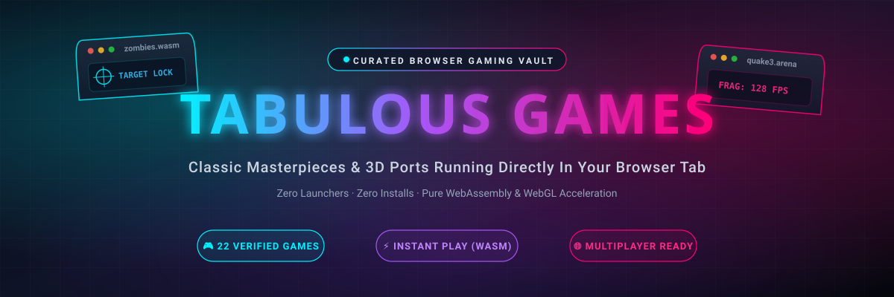

# 🎮 Tabulous Games — The Curated Browser Gaming Vault

[](index.html)
[](https://github.com/LIN4CRE/retro-arcade-vault)
[](https://webassembly.org/)
[](LICENSE)

> **Classic PC masterpieces, iconic shooters, zombies co-op, survivors-likes, and 3D open-world adventures running natively inside your browser tab.** Zero launchers, zero installs, pure WebAssembly, WebGL & WebGPU acceleration.

<p align="center">
  
</p>

---

## 🕹️ Sister Project: Retro Arcade Vault

Looking for vintage console gems? Check out our companion project [**Retro Arcade Vault**](https://github.com/LIN4CRE/retro-arcade-vault) ([Live Demo](https://lin4cre.github.io/retro-arcade-vault/))!

<p align="center">
  <a href="https://github.com/LIN4CRE/retro-arcade-vault">
    
  </a>
</p>

*   **Retro Arcade Vault**: Preloaded with **124 console classics** across PlayStation 1, Game Boy Advance, Nintendo DS, Super Nintendo, and Sega Genesis.
*   **Tabulous Games**: Dedicated to **3D PC ports, shooters, zombies, survivors-likes, and WebAssembly reconstructions**.

Together, they form the ultimate browser-based gaming suite!

---

## 🆕 October 2026 expansion — 9 survivors-likes and 12 new ports

This update was driven by a broad search for **survivors-likes playable in a browser tab** and for **new fan ports** of classic games. Two old entries were removed because their hosts no longer serve a game (see the audit below).

**Survivors & roguelite (9):**

| Title | What it is | Play link |
| :--- | :--- | :--- |
| **Azeroth Survivors** | WoW Classic survivors roguelike by Aethus (WebGPU, 9 classes, 12 zones) — the game also searched as *World of Warcraft Survivors* | [wow.aethus.pl](https://wow.aethus.pl/) |
| **Diablo Survivors** | 3D third-person Diablo survivors-like with drop-in co-op, by izkimar on Spawn | [spawn.co/@izkimar](https://www.spawn.co/@izkimar/diablo-survivors) |
| **D2 Survivors** | Diablo II survivors-like with all 7 classes and D2 loot — needs your own D2/D2R files | [d2survivors.lol](https://d2survivors.lol/play/) |
| **PokéBonk** | 3D Megabonk-style Pokémon survivor by Charcher | [pokebonk.com](https://pokebonk.com/) |
| **PokéSurvivor** | 2D bullet-heaven with 966 Pokémon and 4-player co-op | [pokesurvivor.com](https://pokesurvivor.com/) |
| **Pokémon Survivors** | 15-minute runs, 27 starters, megas, rifts and legendary bosses | [pokemonsurvivors.com](https://www.pokemonsurvivors.com/en/) |
| **Bacon Survivor** | The verified pig/pork-themed survivor game by SnoutUp | [poki.com](https://poki.com/en/g/bacon-survivor) |
| **PokeBonk (Touchzada)** | A second, separate PokeBonk with missions, shop and 8-player online runs | [pokebonk.solais.cloud](https://pokebonk.solais.cloud/) |
| **The Browsing of Isaac** | *Repentance+* recompiled to WebAssembly, streamed in a tab | [tboi.online](https://tboi.online/) |

**New ports & classics (12):** Doom (Wasm Doom), Crash Bash Online, Tomb Raider (OpenLara), Transport Tycoon (OpenTTD Online), Red Alert 2 (Chrono Divide), Road Rash, WipEout, LEGO Island, Lugaru, Alley Cat, SimCity Classic and Cricket 07. Full details, controls and caveats are in the cards and in the table below.

> **Search notes:** no game literally titled *Pork Survivors* could be verified — the closest is **Bacon Survivor**. *World of Warcraft Survivors* and *WoW Survivors* resolve to **Azeroth Survivors**. *Diablo II Survivors* is **D2 Survivors**, while **Diablo Survivors** (Spawn) is a separate 3D co-op game.

---

## 🚀 The Curated Library (41 entries, 32 instant-play)

Every card links to the project's own site. Large downloads, WebGPU requirements and "bring your own game files" cases are called out in each card's **Good to Know** box rather than hidden:

<!-- GAMES-TABLE:START -->
| Game Title | Platform / Tech | Genre | Status |
| :--- | :--- | :--- | :--- |
| **PokeBonk (Touchzada, 8-Player)** 🆕 | HTML5 Canvas / Online Rooms | Survivors &amp; Roguelite | ⚡ Instant Play |
| **Azeroth Survivors (World of Warcraft Survivors)** 🆕 | WebGPU / Rust + Bevy WASM | Survivors &amp; Roguelite | ⚡ Instant Play |
| **Diablo Survivors (3D Multiplayer)** 🆕 | WebGL / Spawn Engine | Survivors &amp; Roguelite | ⚡ Instant Play |
| **D2 Survivors (Diablo II Survivors)** 🆕 | WebAssembly / Own D2 Files | Survivors &amp; Roguelite | 📁 Custom Files |
| **PokéBonk (3D Pokémon Survivors)** 🆕 | WebGL / 3D Megabonk-style | Survivors &amp; Roguelite | ⚡ Instant Play |
| **PokéSurvivor (966 Pokémon)** 🆕 | HTML5 Canvas / WebGL | Survivors &amp; Roguelite | ⚡ Instant Play |
| **Pokémon Survivors (Bullet Heaven)** 🆕 | HTML5 / Canvas | Survivors &amp; Roguelite | ⚡ Instant Play |
| **Bacon Survivor (Pork Survivors-like)** 🆕 | HTML5 / Canvas | Survivors &amp; Roguelite | ⚡ Instant Play |
| **The Binding of Isaac: Repentance+ (The Browsing of Isaac)** 🆕 | WebAssembly / Static Recompilation | Survivors &amp; Roguelite | ⚡ Instant Play |
| **Doom (Wasm Doom)** 🆕 | Chocolate Doom WASM / WebSockets | Classic PC &amp; Retro Ports | ⚡ Instant Play |
| **Crash Bash Online** 🆕 | WebGL / Server-side Game Logic | Sports &amp; Arcade | 🌐 Multiplayer |
| **Tomb Raider (OpenLara)** 🆕 | WebGL / WebAssembly Engine Rewrite | Classic PC &amp; Retro Ports | ⚡ Instant Play |
| **OpenTTD Online (Transport Tycoon)** 🆕 | WebAssembly / OpenGFX | Strategy &amp; Sim | ⚡ Instant Play |
| **Chrono Divide (Red Alert 2)** 🆕 | WebGL / JavaScript Engine Rewrite | Strategy &amp; Sim | 📁 Custom Files |
| **Road Rash (Three.js Port)** 🆕 | Three.js / WebGL | Sports &amp; Arcade | ⚡ Instant Play |
| **WipEout (wipeout-rewrite)** 🆕 | WebAssembly / WebGL | Sports &amp; Arcade | ⚡ Instant Play |
| **LEGO Island (isle.pizza)** 🆕 | WebAssembly / Decompilation | Open World &amp; Action | ⚡ Instant Play |
| **Lugaru (Lugaru-Web)** 🆕 | WebAssembly / OSS Lugaru | Open World &amp; Action | ⚡ Instant Play |
| **Alley Cat (alleycat.exe)** 🆕 | Static Recompilation / WASM | Classic PC &amp; Retro Ports | ⚡ Instant Play |
| **SimCity Classic (micropolisJS)** 🆕 | JavaScript / HTML5 Canvas | Strategy &amp; Sim | ⚡ Instant Play |
| **Cricket 07 (Browser Recompilation)** 🆕 | WebAssembly / WebGPU Recompilation | Sports &amp; Arcade | ⚡ Instant Play |
| **Call of Duty: Black Ops — Zombies** | WebGL / WebAssembly Canvas | Zombies &amp; Co-op | ⚡ Instant Play |
| **Call of Duty: Black Ops — Moon** | WebGL / Cloudflare Pages | Zombies &amp; Co-op | ⚡ Instant Play |
| **Call of Duty: Black Ops — Kino der Toten** | WebGL / Cloudflare Pages | Zombies &amp; Co-op | ⚡ Instant Play |
| **Counter-Strike Surf (Surfd.net)** | WebGL / Source Physics Engine | Shooters &amp; FPS | ⚡ Instant Play |
| **Halo: Combat Evolved (Web Port)** | WebGL / WebAssembly Engine | Shooters &amp; FPS | ⚡ Instant Play |
| **Halo: Combat Evolved Mobile / Web (HCEMobile)** | WebAssembly / WebGL / Gamepad API | Shooters &amp; FPS | 📁 Custom Files |
| **Skate 3 (Web Fan Project)** | WebGL / Canvas Physics | Sports &amp; Arcade | ⚡ Instant Play |
| **Pro Evolution Soccer 6 (PES 6 Web)** | PPSSPP WebAssembly Emulation | Sports &amp; Arcade | ⚡ Instant Play |
| **Grand Theft Auto: Vice City (reVC WASM)** | reVC WebAssembly / WebGL | Open World &amp; Action | ⚡ Instant Play |
| **Grand Theft Auto III (re3 WASM)** | re3 WebAssembly / WebGL | Open World &amp; Action | ⚡ Instant Play |
| **The Simpsons: Hit &amp; Run (SHAR WASM)** | WebAssembly / Cloudflare Workers | Open World &amp; Action | ⚡ Instant Play |
| **The Simpsons: Hit &amp; Run (WASM Arcade Mirror)** | WASM Arcade Pipeline | Open World &amp; Action | ⚡ Instant Play |
| **Minecraft Java 1.8.8 (Eaglercraft WASM)** | TeaVM / WebAssembly Java | Open World &amp; Action | ⚡ Instant Play |
| **Quake (QuakeWorld Online)** | WebQuake / WebGL / WebSockets | Classic PC &amp; Retro Ports | 🌐 Multiplayer |
| **Quake II (JSQuake II)** | WebGL / WebAssembly Netcode | Classic PC &amp; Retro Ports | 🌐 Multiplayer |
| **Quake III Arena (ioquake3 Web)** | ioquake3 WebAssembly / WebGL | Classic PC &amp; Retro Ports | 🌐 Multiplayer |
| **Return to Castle Wolfenstein (iortcw Web)** | iortcw WebAssembly / WebGL | Classic PC &amp; Retro Ports | 🌐 Multiplayer |
| **Urban Terror (ut.pieter.com)** | ioquake3 WebAssembly | Shooters &amp; FPS | ⚡ Instant Play |
| **Half-Life (Pixelsuft WebXash)** | Xash3D FWGS WebAssembly | Classic PC &amp; Retro Ports | ⚡ Instant Play |
| **Counter-Strike 1.6 &amp; Half-Life (webXash)** | Xash3D WebAssembly Framework | Shooters &amp; FPS | 📁 Custom Files |
| **Diablo 1 (DiabloWeb / DevilutionX)** | DevilutionX WebAssembly | Classic PC &amp; Retro Ports | ⚡ Instant Play |
<!-- GAMES-TABLE:END -->

Legend: ⚡ instant play · 🌐 online multiplayer · 📁 needs your own game files / add-ons.

---

## 🤖 The 24-hour discovery bot

The catalogue now looks after itself. A GitHub Action runs **once every 24 hours** (06:17 UTC) and does four things without any input:

1. **Scans** [PortedGames](https://portedgames.com/) (its daily-checked changelog and every browser port it tracks), the public [Spawn](https://www.spawn.co/) feed filtered to survivors/roguelite, and a curated watchlist in `data/discovery-sources.json`.
2. **Verifies** every new link and re-checks all existing catalogue links, spotting 404/410s, timeouts and domains that now redirect somewhere unrelated.
3. **Publishes and repairs**: `scripts/auto-publish.mjs` adds up to three strong, fully verified finds per run (marked `AUTO-DISCOVERED` and honest about being machine-found), and retires entries whose host has definitively gone — moving them to the audit list with a reason. Timeouts, 5xx and bot-checks never trigger a removal.
4. **Reports**: rewrites `data/status.json` (the site's heartbeat), `data/discoveries.json` / `.md`, commits everything, and opens or refreshes a `discovery` issue when something needs a human.

GitHub Pages redeploys from `main` on that commit, so the live site updates itself.

### "When was this last scanned?"

Every visitor sees it: a status panel above the filters reads `data/status.json` and shows the last scan time (UTC), how long ago it was, when the next one is due, new finds awaiting review, links re-checked and how many entries were auto-added. The dot is green under 30 hours, amber to 72, red beyond that — so a stalled bot is obvious at a glance. If you open `index.html` from disk (no server), it falls back to the copy baked in at build time.

### Running it by hand

```bash
npm run check        # build --check + cover check (what CI runs)
npm run discover     # scan the web now, write data/discoveries.*
npm run auto         # publish verified finds + retire dead links
npm run status       # refresh data/status.json
npm run build        # regenerate index.html + README
npm run covers       # generate any missing SVG covers
npm run pending      # list staged candidates
npm run daily        # the whole daily cycle in one command
npm start            # serve the site on :8000
```

Or trigger the workflow yourself: **Actions → Discover new browser games → Run workflow**.

> **Note:** GitHub currently refuses to start Actions jobs on this account ("The job was not started because your account is locked due to a billing issue"). The workflows are valid and will run on schedule as soon as billing is resolved; until then `npm run discover && npm run auto && npm run status && npm run build` reproduces the entire daily cycle locally.

---

## 🔍 Transparency audit

The full, generated list of excluded links is rendered at the bottom of the site and stored in the `excluded` array of `games.json`. It currently covers **6** entries:

*   **Call of Duty: Black Ops III — Cheese Cube** — taken down; the old `cheese-cube.pages.dev` domain now redirects to an unrelated casino site.
*   **Call of Duty: Black Ops II (Vibe Slops II)** — offline; the author reports a DMCA takedown from Activision and all games on that host are down.
*   The original four audit entries (Modern Warfare 2 railway host, Skate Rust storefront, truncated GTA 5 Wayback link and the broken Hedgewars host) remain excluded.

Removals are never silent: they are moved to `excluded` with a reason and a date.

---

## 📁 Project Structure

```text
tabulous-games/
├── index.html                       # Portal with live search, category/status filters and generated cards
├── README.md                        # This document (table + counts generated by scripts/build.mjs)
├── LICENSE                          # MIT Open Source License
├── games.json                       # Single source of truth: games, categories, audit list
├── data/
│   ├── discovery-sources.json       # Where the daily scanner looks
│   ├── discoveries.json             # Latest scan output (committed by the bot)
│   ├── discoveries.md               # Human-readable scan report
│   └── status.json                  # Heartbeat shown in the site's status panel
├── fixtures/                        # Offline samples used to test the discovery parsers
├── scripts/
│   ├── discover-games.mjs           # Automated search + link verification
│   ├── auto-publish.mjs             # Publish verified finds, retire dead links
│   ├── finalise-games.mjs           # Turn staged discoveries into games.json drafts
│   ├── write-status.mjs             # Refresh data/status.json after each scan
│   ├── make-covers.mjs              # Vector cover generator
│   ├── build.mjs                    # Regenerates index.html + README from games.json
│   └── add-2026-10-games.py         # Migration record for the October 2026 batch
└── assets/
    ├── banner.svg                   # Holographic vector header banner
    ├── retro-arcade-sticker.svg     # Sister repo clickable sticker badge
    └── covers/                      # Local cover art for every game (raster + generated SVG)
```

---

## ✅ Verification policy

1.  A link only enters the grid if it resolves to a playable client in a desktop browser.
2.  Games that need the original data files are labelled **📁 Custom Files** and say which files are required.
3.  WebGPU-only games and very large first loads are labelled in **Good to Know**.
4.  Links are re-checked daily by the discovery workflow; games that stop serving a client are moved to the audit list with a reason.
5.  Unofficial fan projects are credited as such — trademarks and game data belong to their owners.

---

## 🛠️ How to Run

### Direct Local Play
Double-click `index.html` in File Explorer. Because all cover art and vector assets are bundled locally, the entire dashboard functions 100% offline or online with zero configuration.

### Hosting on GitHub Pages
1. Push this folder to a GitHub repository (e.g. `LIN4CRE/tabulous-games`).
2. Go to **Settings** > **Pages** and set the source branch to `main`.
3. Your site will be live instantly.

---

## 💚 Support the project

If the catalogue has saved you a download or two, you can **Buy Me a Smoke** — the button in the header and footer links to [paypal.me/dlinacre16](https://paypal.me/dlinacre16). Entirely optional; every game stays free.

---

## 📄 License
MIT License. Created with passion for retro preservation and web technologies.
