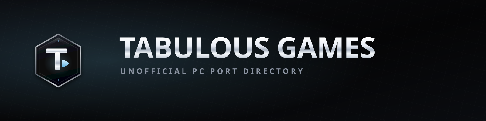

# Tabulous Games — The Unofficial PC Port Directory


[](https://lin4cre.github.io/tabulous-games/)
[](index.html)
[](https://www.dsogaming.com/news/super-mario-odyssey-unofficial-pc-port-available-for-download/)
[](LICENSE)

> **A fixed, hand-curated directory of unofficial native PC ports.** Every entry is a game from [DSOGaming's *Super Mario Odyssey Unofficial PC Port Available for Download* round-up](https://www.dsogaming.com/news/super-mario-odyssey-unofficial-pc-port-available-for-download/) (2 November 2026) — and nothing else.

<p align="center">
  
</p>

This repo was rebuilt from scratch around that one list. The old 303-game browser catalogue, its daily discovery bot, its survivors-like expansion write-ups and the transparency audit are gone. What remains is a single-purpose site: **79 unofficial PC ports**, each card linking to the download or project page used in the round-up.

These are *native* PC ports built by community decompilation / recompilation projects. They are not browser games: they run as desktop builds, and **you need your own legally dumped copy of the original game**. This repo hosts no game files, no installers and no ROMs.

---

## 🕹️ Sister project

<p align="center">
  <a href="https://github.com/LIN4CRE/retro-arcade-vault">
    
  </a>
</p>

* **Retro Arcade Vault** — vintage console classics in the browser.
* **Tabulous Games** — this directory of unofficial native PC ports.

---

## 📋 What's on the list

The round-up names 79 games. Two shorthand mentions are expanded so that each game gets its own card:

* *"the three classic SNES Donkey Kong Country games"* → **Donkey Kong Country**, **Donkey Kong Country 2**, **Donkey Kong Country 3**.
* *"all the Gears of War games from the Xbox 360 era"* → **Gears of War**, **Gears of War 2**, **Gears of War 3**, **Gears of War: Judgment**.

Games mentioned twice in the article (for example **Bloodborne**) appear once. A few articles cover more than one port, so some cards intentionally share a source link.

The collection spans five groups: Nintendo consoles, PlayStation consoles, Xbox consoles, arcade/Sega boards, and multi-platform releases. Use the filter pills at the top of the site to jump between them.

---

## 🚀 The Port Directory (79 entries, 79 need your own files)

Every card links to the port's project page or announcement. The **Good to Know** box repeats the one rule that applies to all of them: bring your own game files.

<!-- GAMES-TABLE:START -->
| Game | Port type | Original platform (year) | Requirements |
| :--- | :--- | :--- | :--- |
| **Super Mario Odyssey** | Native PC port / static recompilation | Nintendo Consoles · Switch (2017) | 📁 Own game files |
| **Mario Kart Wii** | Native PC port / static recompilation | Nintendo Consoles · Wii (2008) | 📁 Own game files |
| **Super Mario 64** | Native PC port / static recompilation | Nintendo Consoles · N64 (1996) | 📁 Own game files |
| **Mario Kart 64** | Native PC port / static recompilation | Nintendo Consoles · N64 (1996) | 📁 Own game files |
| **Super Mario Sunshine** | Native PC port / static recompilation | Nintendo Consoles · GameCube (2002) | 📁 Own game files |
| **Super Mario Galaxy** | Native PC port / static recompilation | Nintendo Consoles · Wii (2007) | 📁 Own game files |
| **Super Mario Strikers** | Native PC port / static recompilation | Nintendo Consoles · GameCube (2005) | 📁 Own game files |
| **Crash Team Racing** | Native PC port / static recompilation | PlayStation Consoles · PS1 (1999) | 📁 Own game files |
| **Forza Horizon 2** | Native PC port / static recompilation | Xbox Consoles · Xbox 360 (2014) | 📁 Own game files |
| **Duke Nukem: Zero Hour** | Native PC port / static recompilation | Nintendo Consoles · N64 (1999) | 📁 Own game files |
| **The Legend of Zelda: Ocarina of Time** | Native PC port / static recompilation | Nintendo Consoles · N64 (1998) | 📁 Own game files |
| **The Legend of Zelda: Wind Waker** | Native PC port / static recompilation | Nintendo Consoles · GameCube (2002) | 📁 Own game files |
| **Majora’s Mask** | Native PC port / static recompilation | Nintendo Consoles · N64 (2000) | 📁 Own game files |
| **Perfect Dark** | Native PC port / static recompilation | Nintendo Consoles · N64 (2000) | 📁 Own game files |
| **Call of Duty 3** | Native PC port / static recompilation | Multi-platform · Multi (2006) | 📁 Own game files |
| **Jak &amp; Daxter** | Native PC port / static recompilation | PlayStation Consoles · PS2 (2001) | 📁 Own game files |
| **The Simpsons Game** | Native PC port / static recompilation | Multi-platform · Multi (2007) | 📁 Own game files |
| **Peter Jackson’s King Kong** | Native PC port / static recompilation | Xbox Consoles · Xbox 360 (2005) | 📁 Own game files |
| **Gears of War 3** | Native PC port / static recompilation | Xbox Consoles · Xbox 360 (2011) | 📁 Own game files |
| **Bloodborne** | Native PC port / static recompilation | PlayStation Consoles · PS4 (2015) | 📁 Own game files |
| **Virtua Fighter Arcade** | Native PC port / static recompilation | Arcade &amp; Sega · Arcade (1993) | 📁 Own game files |
| **Splinter Cell: Double Agent** | Native PC port / static recompilation | Xbox Consoles · Xbox (2006) | 📁 Own game files |
| **Tekken 6** | Native PC port / static recompilation | Multi-platform · Multi (2009) | 📁 Own game files |
| **The Legend of Zelda: Wind Waker HD** | Native PC port / static recompilation | Nintendo Consoles · Wii U (2013) | 📁 Own game files |
| **The Legend of Zelda: Breath of the Wild** | Native PC port / static recompilation | Nintendo Consoles · Wii U (2017) | 📁 Own game files |
| **Bayonetta 2** | Native PC port / static recompilation | Nintendo Consoles · Wii U (2014) | 📁 Own game files |
| **Metroid Dread** | Native PC port / static recompilation | Nintendo Consoles · Switch (2021) | 📁 Own game files |
| **Metroid Prime** | Native PC port / static recompilation | Nintendo Consoles · GameCube (2002) | 📁 Own game files |
| **Star Fox** | Native PC port / static recompilation | Nintendo Consoles · SNES (1993) | 📁 Own game files |
| **F-Zero** | Native PC port / static recompilation | Nintendo Consoles · SNES (1990) | 📁 Own game files |
| **Donkey Kong Country** | Native PC port / static recompilation | Nintendo Consoles · SNES (1994) | 📁 Own game files |
| **Donkey Kong Country 2: Diddy’s Kong Quest** | Native PC port / static recompilation | Nintendo Consoles · SNES (1995) | 📁 Own game files |
| **Donkey Kong Country 3: Dixie Kong’s Double Trouble!** | Native PC port / static recompilation | Nintendo Consoles · SNES (1996) | 📁 Own game files |
| **Mother 2/EarthBound** | Native PC port / static recompilation | Nintendo Consoles · SNES (1994) | 📁 Own game files |
| **SCUD RACE** | Native PC port / static recompilation | Arcade &amp; Sega · Arcade (1996) | 📁 Own game files |
| **The Lost World: Jurassic Park** | Native PC port / static recompilation | Arcade &amp; Sega · Arcade (1997) | 📁 Own game files |
| **Time Crisis** | Native PC port / static recompilation | Arcade &amp; Sega · Arcade (1995) | 📁 Own game files |
| **Rave Racer** | Native PC port / static recompilation | Arcade &amp; Sega · Arcade (1995) | 📁 Own game files |
| **Time Crisis 2** | Native PC port / static recompilation | Arcade &amp; Sega · Arcade (1997) | 📁 Own game files |
| **Virtua Fighter 2** | Native PC port / static recompilation | Arcade &amp; Sega · Arcade (1994) | 📁 Own game files |
| **Gears of War** | Native PC port / static recompilation | Xbox Consoles · Xbox 360 (2006) | 📁 Own game files |
| **Gears of War: Judgment** | Native PC port / static recompilation | Xbox Consoles · Xbox 360 (2013) | 📁 Own game files |
| **God of War** | Native PC port / static recompilation | PlayStation Consoles · PS2 (2005) | 📁 Own game files |
| **Super Smash Bros. Brawl** | Native PC port / static recompilation | Nintendo Consoles · Wii (2008) | 📁 Own game files |
| **Xenoblade Chronicles X: Definitive Edition** | Native PC port / static recompilation | Nintendo Consoles · Switch (2025) | 📁 Own game files |
| **Shadow of the Colossus** | Native PC port / static recompilation | PlayStation Consoles · PS4 (2018) | 📁 Own game files |
| **MediEvil** | Native PC port / static recompilation | PlayStation Consoles · PS4 (2019) | 📁 Own game files |
| **Killzone Shadow Fall** | Native PC port / static recompilation | PlayStation Consoles · PS4 (2013) | 📁 Own game files |
| **Driveclub** | Native PC port / static recompilation | PlayStation Consoles · PS4 (2014) | 📁 Own game files |
| **God of War 3 Remastered** | Native PC port / static recompilation | PlayStation Consoles · PS4 (2015) | 📁 Own game files |
| **Gran Turismo Sport** | Native PC port / static recompilation | PlayStation Consoles · PS4 (2017) | 📁 Own game files |
| **Uncharted: The Nathan Drake Collection** | Native PC port / static recompilation | PlayStation Consoles · PS4 (2015) | 📁 Own game files |
| **The Order: 1886** | Native PC port / static recompilation | PlayStation Consoles · PS4 (2015) | 📁 Own game files |
| **The Last Guardian** | Native PC port / static recompilation | PlayStation Consoles · PS4 (2016) | 📁 Own game files |
| **Zelda 2: The Adventure of Link** | Native PC port / static recompilation | Nintendo Consoles · NES (1987) | 📁 Own game files |
| **WET** | Native PC port / static recompilation | Multi-platform · Multi (2009) | 📁 Own game files |
| **The Darkness** | Native PC port / static recompilation | Multi-platform · Multi (2007) | 📁 Own game files |
| **Spider-Man: Edge of Time** | Native PC port / static recompilation | Multi-platform · Multi (2011) | 📁 Own game files |
| **Mercenaries** | Native PC port / static recompilation | Multi-platform · Multi (2005) | 📁 Own game files |
| **GTA: Liberty City Stories** | Native PC port / static recompilation | PlayStation Consoles · PS2 (2005) | 📁 Own game files |
| **Fable 2** | Native PC port / static recompilation | Xbox Consoles · Xbox 360 (2008) | 📁 Own game files |
| **Burnout Revenge** | Native PC port / static recompilation | Multi-platform · Multi (2005) | 📁 Own game files |
| **Lost Odyssey** | Native PC port / static recompilation | Xbox Consoles · Xbox 360 (2007) | 📁 Own game files |
| **Mario Party 4** | Native PC port / static recompilation | Nintendo Consoles · GameCube (2002) | 📁 Own game files |
| **Sonic Unleashed** | Native PC port / static recompilation | Multi-platform · Multi (2008) | 📁 Own game files |
| **GoldenEye 007** | Native PC port / static recompilation | Nintendo Consoles · N64 (1997) | 📁 Own game files |
| **The Legend of Zelda: Twilight Princess** | Native PC port / static recompilation | Nintendo Consoles · GameCube (2006) | 📁 Own game files |
| **Silent Hill** | Native PC port / static recompilation | PlayStation Consoles · PS1 (1999) | 📁 Own game files |
| **Gears of War 2** | Native PC port / static recompilation | Xbox Consoles · Xbox 360 (2008) | 📁 Own game files |
| **Syphon Filter** | Native PC port / static recompilation | PlayStation Consoles · PS1 (1999) | 📁 Own game files |
| **Diddy Kong Racing** | Native PC port / static recompilation | Nintendo Consoles · N64 (1997) | 📁 Own game files |
| **Ace Combat 6** | Native PC port / static recompilation | Xbox Consoles · Xbox 360 (2007) | 📁 Own game files |
| **Wave Race 64** | Native PC port / static recompilation | Nintendo Consoles · N64 (1996) | 📁 Own game files |
| **Blue Dragon** | Native PC port / static recompilation | Xbox Consoles · Xbox 360 (2006) | 📁 Own game files |
| **Pikmin** | Native PC port / static recompilation | Nintendo Consoles · GameCube (2001) | 📁 Own game files |
| **Ninja Gaiden 2** | Native PC port / static recompilation | Xbox Consoles · Xbox 360 (2008) | 📁 Own game files |
| **Super Smash Bros. Ultimate** | Native PC port / static recompilation | Nintendo Consoles · Switch (2018) | 📁 Own game files |
| **Super Paper Mario** | Native PC port / static recompilation | Nintendo Consoles · Wii (2007) | 📁 Own game files |
| **Tekken 3** | Native PC port / static recompilation | PlayStation Consoles · PS1 (1997) | 📁 Own game files |
<!-- GAMES-TABLE:END -->

Legend: 📁 needs your own game files. That is the only status in this directory — none of these ports are instant-play browser games.

---

## 🔗 Where the links point

* **Super Mario Odyssey** → the [Power Moon Recomp GitLab project](https://gitlab.com/zzzarathustra-dev/power-moon-recomp) (the round-up's "download from here" link). Only game version **1.0.0** is supported: on first run you select your dumped files, the setup validates and copies them, then builds the PC version once.
* **F-Zero** → the [FZeroRecomp GitHub project](https://github.com/craigshaw/FZeroRecomp).
* **Everything else** → the DSOGaming article linked for that game in the round-up.

All links are editorial references, not verified mirrors. Download pages can move; if one breaks, open an issue.

---

## 🧱 How the site is built

`games.json` is the single source of truth. `scripts/build.mjs` regenerates the card grid inside `index.html` and the table above; `scripts/make-covers.mjs` draws a deterministic 1280×720 SVG cover for each game. `scripts/seed-catalog.mjs` holds the curated list of games and source links and can rewrite `games.json` from it.

```bash
npm run check        # build --check + cover check (what CI runs)
npm run covers       # regenerate any missing SVG covers
npm run build        # regenerate index.html + README table from games.json
npm run seed         # rebuild games.json from the curated port list
npm run brand        # regenerate emblem PNGs / favicons / OG card
npm start            # serve the site on :8000
```

To add or change a port, edit `PORTS` / `LINKS` in `scripts/seed-catalog.mjs`, then run `npm run seed && npm run covers && npm run build`.

---

## 📁 Project structure

```text
tabulous-games/
├── index.html                    # The site: live search, platform filters, generated cards
├── README.md                     # This document (table + counts generated by build.mjs)
├── games.json                    # Single source of truth: ports, categories, provenance
├── manifest.webmanifest          # PWA metadata
├── robots.txt · sitemap.xml      # Crawler hints for the Pages deployment
├── favicon.ico                   # Legacy icon bundle
├── scripts/
│   ├── seed-catalog.mjs          # Curated port list + source links → games.json
│   ├── build.mjs                 # Regenerates index.html + README from games.json
│   ├── make-covers.mjs           # Deterministic vector covers (one per port)
│   └── make-brand.mjs            # Regenerates emblem PNGs, favicons, OG card, wordmark
└── assets/
    ├── brand/                    # Emblem, favicons, apple-touch icon, OG card, banner
    ├── fonts/                    # Self-hosted Manrope 700/800
    ├── banner.svg                # Fallback art for missing covers
    ├── retro-arcade-sticker.svg  # Sister-repo badge
    └── covers/                   # One generated SVG cover per port
```

---

## ✅ Policy

1. Only the games named in the round-up are listed. No auto-discovery, no scraping, no scheduled additions.
2. Every entry is an **unofficial fan project**; nothing here is affiliated with or endorsed by the rights holders.
3. You must own the original game and dump its files yourself. No game data is bundled or mirrored.
4. Requirements and version caveats are stated on each card, and the linked page is the authority for downloads and setup.
5. Trademarks and game assets belong to their owners.

---

## 🛠️ How to run

### Locally
Open `index.html` directly — all covers and fonts are bundled, so the directory works offline. Or run `npm start` and visit `http://localhost:8000`.

### GitHub Pages
Push this folder to a repository, then set **Settings → Pages** to deploy from the default branch.

---

## 🎨 Design system

The site is one self-contained HTML file with a small design system: dark chrome surfaces, a sky-blue accent, a purple "own files" status, and platform-tinted cover art generated from each game id. Type is self-hosted Manrope 700/800; icons are an inline SVG sprite; reveal and hover motion collapse under `prefers-reduced-motion`.

Regenerate brand art after editing `assets/brand/emblem.svg`:

```bash
npm i --no-save sharp @resvg/resvg-js typeface-manrope
node scripts/make-brand.mjs
```

---

## 💚 Support the project

Tabulous Games is the work of one solo developer — no ads, no tracking, no affiliate links. If the directory saved you some searching, you can **Buy Me a Smoke** via [paypal.me/dlinacre16](https://paypal.me/dlinacre16). Entirely optional.

---

## 📄 License

MIT License. Created with passion for game preservation and the people who keep old games playable.
